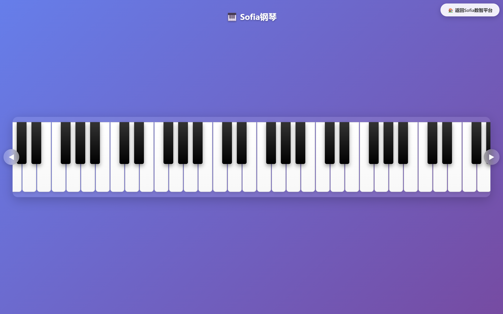

# Sofia 钢琴

<!-- en-intro -->
**Sofia Piano** — an 88-key piano simulator served locally by Flask; play with the mouse, touch or computer keyboard.
<!-- /en-intro -->

---

一个使用 Flask 提供本机网页的钢琴模拟器。页面提供 88 个琴键、鼠标和触屏演奏、电脑键盘映射、音频预加载与横向滚动浏览。

## 运行环境

- Windows、macOS 或 Linux
- Python 3.9+
- Flask（由 requirements.txt 安装）
- 现代浏览器；首次打开时需等待 88 个音频样本加载完成

## 安装与启动

在项目目录执行：

    python -m venv .venv

Windows：

    .venv\Scripts\Activate.ps1
    python -m pip install -r requirements.txt
    python app.py

macOS / Linux：

    source .venv/bin/activate
    python -m pip install -r requirements.txt
    python app.py

打开 http://127.0.0.1:5051/piano/。服务只绑定本机回环地址 127.0.0.1，不会监听局域网或公网地址。停止时在运行窗口按 Ctrl+C。

默认端口为 5051。如需换端口，可在启动前设置 PIANO_PORT：

    $env:PIANO_PORT = "5052"
    python app.py

## 使用方法

- 点击或触摸琴键演奏。
- 也可使用页面提示的电脑键盘按键演奏。
- 页面会在启动时依次加载 static/sounds/ 下的 MP3 文件。浏览器控制台可查看加载问题。
- 窄屏可用页面的左右按钮浏览琴键。

## 项目结构

    piano_git/
    ├── app.py                 # 本机 Flask 启动入口
    ├── __init__.py            # /piano 蓝图
    ├── requirements.txt
    ├── templates/
    │   └── piano_index.html   # 钢琴页面与交互逻辑
    └── static/
        └── sounds/            # 88 个自制钢琴音符 MP3 文件

## 音频素材

static/sounds/ 中的 88 个钢琴音符 MP3 文件由项目作者自行制作。作者确认允许将这些文件随项目公开发布。音频文件不属于 MIT License 授权范围；公开仓库不代表授予复制、改编、再发布或商用许可。需要将音频用于其他项目时，请另行取得作者许可。

## 许可证

MIT License 仅适用于本项目原创程序代码，包括 Flask 启动代码和页面代码，详见 LICENSE。88 个 MP3 音频文件不在该许可证范围内。
